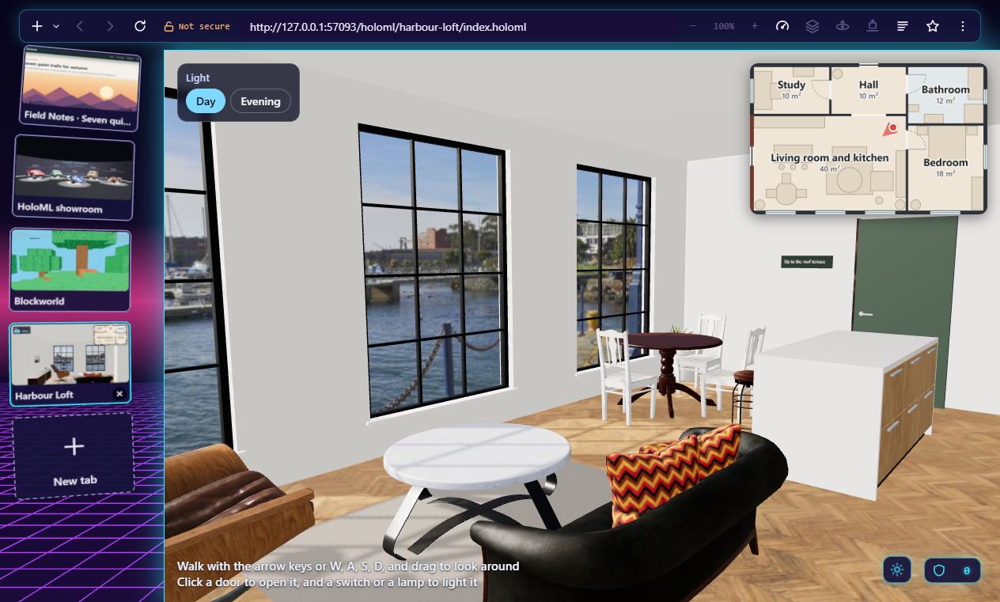
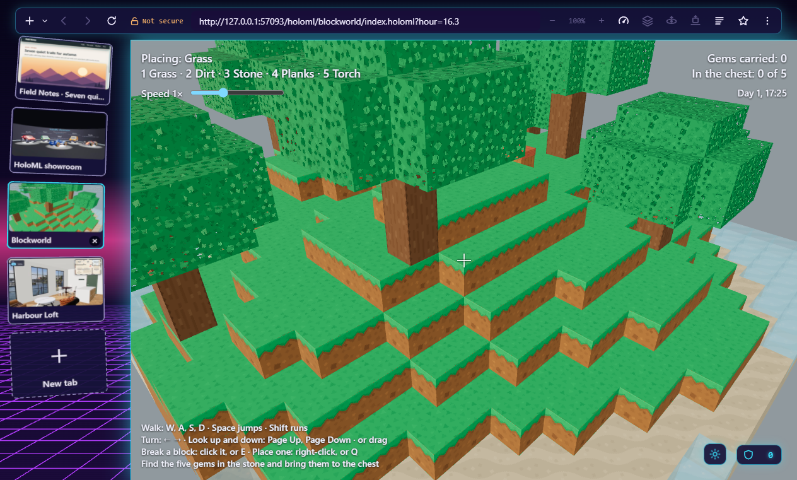
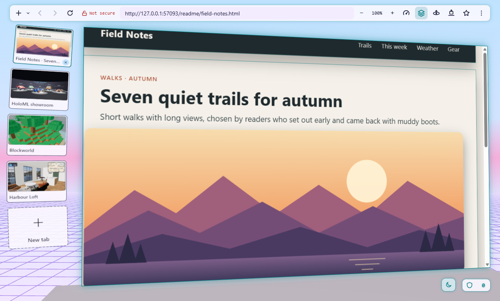
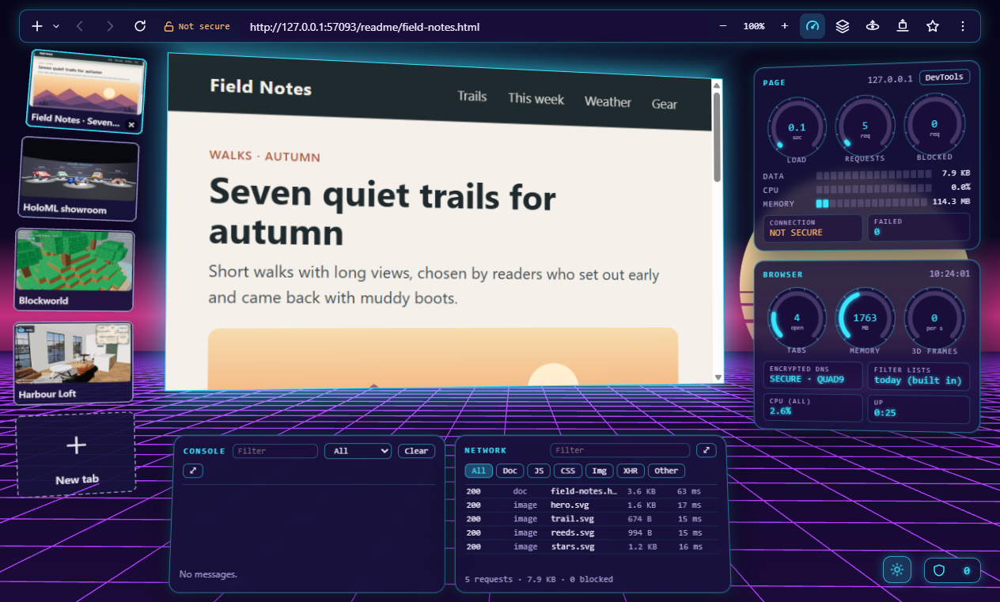
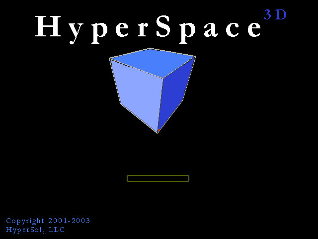

# HyperSol HyperSpace 3D

HyperSpace 3D is an open-source desktop web browser whose interface lives in three
dimensions. It is experimental: a developer preview, not yet for
everyday browsing. Ordinary websites float as panels in a 3D room, page sections
lift into layered depth, and a companion markup language, HoloML, lets
anyone publish a fully 3D website as easily as writing HTML.

<table>
  <tr>
    <td width="50%"></td>
    <td width="50%"></td>
  </tr>
  <tr>
    <td><b>3D websites.</b> <a href="https://github.com/srajpal/holoml/tree/main/examples/harbour-loft">Harbour Loft</a>, written in HoloML: walk through a loft by the harbour, open its doors, switch its lamps on, and go up to the roof terrace.</td>
    <td><b>Games, too.</b> <a href="https://github.com/srajpal/holoml/tree/main/examples/blockworld">Blockworld</a>: walk, break and place blocks, and find five gems, with the mouse or the keyboard alone.</td>
  </tr>
  <tr>
    <td></td>
    <td></td>
  </tr>
  <tr>
    <td><b>Ordinary websites, in depth.</b> Any page on a tilted panel, its sections and pictures lifted into layers; tabs as cards; a dark and a light theme.</td>
    <td><b>An instrument panel.</b> The page's load, requests, and blocked trackers, the browser's own gauges, the console, and the network.</td>
  </tr>
</table>

*The newest build, made with `pnpm screenshots:readme` from local
copies: HoloML's examples (Harbour Loft's furniture, textures, and
harbour from Poly Haven, CC0; Blockworld's blocks from Kenney, CC0) and
a made-up sample page.*

## Download

**[HyperSpace 3D 0.9.1](https://github.com/srajpal/hypersol-hyperspace-3d/releases/tag/v0.9.1)**,
a developer preview, as a portable zip: take the one for your
computer, unzip it anywhere, and start it. Nothing to install, nothing
to sign in to, and no update check: a newer version is a newer zip on
the [releases page](https://github.com/srajpal/hypersol-hyperspace-3d/releases).

| Your computer | Download | Size |
|---|---|---|
| Windows 10 or 11, x64 | [HyperSpace3D-0.9.1-windows-x64.zip](https://github.com/srajpal/hypersol-hyperspace-3d/releases/download/v0.9.1/HyperSpace3D-0.9.1-windows-x64.zip) | 156 MB |
| macOS, Apple silicon (M1 and later) | [HyperSpace3D-0.9.1-macos-arm64.zip](https://github.com/srajpal/hypersol-hyperspace-3d/releases/download/v0.9.1/HyperSpace3D-0.9.1-macos-arm64.zip) | 130 MB |
| macOS, Intel | [HyperSpace3D-0.9.1-macos-x64.zip](https://github.com/srajpal/hypersol-hyperspace-3d/releases/download/v0.9.1/HyperSpace3D-0.9.1-macos-x64.zip) | 134 MB |
| Linux, x64 | [HyperSpace3D-0.9.1-linux-x64.zip](https://github.com/srajpal/hypersol-hyperspace-3d/releases/download/v0.9.1/HyperSpace3D-0.9.1-linux-x64.zip) | 123 MB |

Starting it the first time (nothing is signed, so each system asks
once):

- **Windows:** start `HyperSpace3D.exe` in the unzipped folder.
  SmartScreen says the app is unrecognised: choose *More info*, then
  *Run anyway*.
- **macOS:** keep `HyperSpace 3D.app` where it is or drag it to
  Applications. Gatekeeper refuses to open it: go to System Settings,
  Privacy & Security, and choose *Open Anyway* under the message about
  it; or clear the mark in Terminal with
  `xattr -dr com.apple.quarantine "HyperSpace 3D.app"`.
- **Linux:** start `./HyperSpace3D` in the unzipped folder. On Ubuntu
  24.04 and other systems that restrict user namespaces, it stops at
  once with a message about `chrome-sandbox`: give that helper its
  rights first, in the unzipped folder, with
  `sudo chown root:root chrome-sandbox && sudo chmod 4755 chrome-sandbox`.

Beside each zip on the releases page is its SHA-256 in a `.sha256`
file: check a download with `certutil -hashfile <the zip> SHA256` on
Windows, `shasum -a 256 <the zip>` on macOS, or `sha256sum -c <the
.sha256 file>` on Linux. The browser keeps its data in your system's
usual profile folder and sends nothing anywhere
([docs/privacy.md](docs/privacy.md)). It is a developer preview, not
yet for everyday browsing: the status paragraph below says where it
stands, and [Building and running](#building-and-running) how to run
it from source instead.

**Status (2026-10-16): experimental.** The newest version is the
[0.9.1 developer preview](https://github.com/srajpal/hypersol-hyperspace-3d/releases/tag/v0.9.1),
a pre-release published 2026-10-16 as a portable zip for Windows,
Linux, and macOS ([Download](#download) above) and as source; the
[0.9.0 developer preview](https://github.com/srajpal/hypersol-hyperspace-3d/releases/tag/v0.9.0)
of 2026-09-26 was source only. Windows and Linux are checked by the
automatic tests on every change; macOS builds and passes its unit
tests there, and a Mac in hand passes the end-to-end checks but two
(TODO.md, "Issue #111"). Apache 2.0. No telemetry. There are no
installers, and none are planned (owner, 2026-10-08): a fork may make
one of its own ([CONTRIBUTING.md](CONTRIBUTING.md), "Making your own
build"). Everything since 0.9.0, from HoloML pages to lifting a page's
pictures and models into the room, is in 0.9.1:
[What it does](#what-it-does) lists it, [Progress](#progress) tells it
milestone by milestone with screenshots, and
[CHANGELOG.md](CHANGELOG.md) release by release. No more milestones
are planned: the work continues from the
[GitHub issues](https://github.com/srajpal/hypersol-hyperspace-3d/issues)
(owner, 2026-10-10); see [What comes next](#what-comes-next).

## The story

In December 2000, two computer engineering students who had met at
Florida Atlantic University, Sunny Rajpal and Mauricio Sadicoff, started
a small Florida software company. In early 2001 it became HyperSol, with
a plain mission: build high-quality software that makes people's
time on a computer more productive and more fun.

Their first product was a web browser. HyperSol WebSurfer was born, as
the original site put it, "when we needed some features that no other
browser would allow", starting with control over the pop-up windows that
plagued the web of 2001. Since they were writing a browser anyway, they
kept going. WebSurfer 1.0.0 shipped on March 5, 2001, free, for Windows
95, 98, 2000, and ME. By March 13 it was at version 1.0.6 and updating
itself with a press of Ctrl+U.

Some of what made it different still reads as ahead of its time:

- **Themes** that changed the whole browsing environment, not just the
  colours: new images, new buttons, and matching sounds across the
  application. It shipped with three: Surfer, Space, and Winter.
- **Automatic page refresh** for stock quotes every minute or headlines
  every five seconds.
- **A full HTML editor** built into the browser, with colour-coded source
  and one-click preview.

The site's own pitch was simple: "It's new, it's cool, and it's FREE!"
The company's second product, CheckIfSiteIsStillUp, was named Download
of the Day on TechTV's The Screen Savers in July 2001.

Behind the shipped features sat a bigger idea: a browser where the web
itself is not flat. Sites rendered in three dimensions. A browser you
look into, not at. Between 2001 and 2003 that idea became the concept
for HyperSol's next step after WebSurfer: HyperSpace 3D. An early
concept screen from that work survives, a blue cube tilted toward the
viewer over a loading bar, and is shown below as it was. It was a
concept of its time; there is no claim here that it shipped as a
product.



That was 2001. The hardware, the graphics APIs, and the open web
platform were not ready. Twenty-five years later they are.

## The salute

HyperSol HyperSpace 3D marks the 25th anniversary of HyperSol's
formation by finally building that idea, in the open, for everyone. It keeps the
spirit of the original: free, themed, a little bit cool, and made by
people who wanted a browser that did something no other browser would.

The name comes from that early concept; the spirit comes from
WebSurfer. The mission is the same. The third dimension, this time, is
real. (Until 2026-09-26 this project was called HyperSol WebSurfer 3D.)

HyperSol, the company, no longer exists. HyperSpace 3D is a personal
project that honours it, not a commercial product.

An archived copy of the 2001 site is available through the
[Wayback Machine](https://web.archive.org/web/20010922111629/http://www.hypersol.com/).

## What it does

- Any normal website, live on a tilted page in a 3D room, with tabs as
  cards (or a list in the top bar), an address bar that completes and
  searches, bookmarks, history, and a Library.
- A layers view that lifts a page's sections and pictures to different
  depths.
- Full screen for video players and games, with the browser's own
  notice and Escape to leave.
- Looking around the room: drag on the room, use the
  arrows and W, A, S, D, or press the top bar's button (Ctrl+Shift+K) to
  leave the desk; Escape brings you back, with the page as sharp as
  before.
- Lifting into the room: right-click a picture, a video,
  or a 3D model on a page and choose "Lift into the room", or lift
  everything in view with the top bar's Lift button (Ctrl+Shift+U). They
  stand beside the page; turn one, bring it nearer, or put it back. A
  picture is taken as the page shows it; a model is fetched only from
  the page's own site, and read where it cannot reach the network.
- Privacy on by default: ad and tracker blocking with a shield, encrypted
  DNS, private tabs, and no telemetry. Pages load over HTTPS only,
  with a warning before any site is used over plain HTTP.
- Your data in your hands: one site's cookies and stored
  data seen and cleared in the Library's Sites tab, and bookmarks
  imported from another browser's bookmark file, after a preview, and
  exported to one.
- A password manager using the system's keychain, site permissions
  for the camera, microphone, and location, and a prompt for sites and
  proxies that ask for a user name and password in the browser's own
  dialog (HTTP sign-in; what you type goes to Chromium's handling of the
  request only, and is never saved).
- Two themes, Nebula (a synthwave night) and Daylight (a pastel 1990s
  day), an instrument panel with live readouts, zoom, find in page,
  downloads, printing, remappable shortcuts, and an economy mode with
  sleeping tabs.
- HoloML pages: fully 3D sites you orbit or walk around,
  with limits that keep a heavy scene from exhausting memory, Tab and
  screen-reader access to a scene's links and named things, a text view,
  reduced motion, and a Scene part in the instrument panel.
- Seven HoloML example sites to try, from a new tab's Try HoloML or
  the HoloML examples section (Ctrl+Shift+E): a car showroom,
  Blockworld (a small block game), the sofa studio, Harbour Loft, the
  sneaker store, the ocean tunnel, and Words in a room ([HoloML](#holoml)
  below links to each).
- What a HoloML 0.2 or 0.3 page can do, each shown by one of those
  sites: scripts from the page's own site, sound after the first click
  or key, text on the screen and on boards in the scene, walls and
  gravity, its own walking and turning speeds, sliders and choices on
  the screen, shadows, textured materials, and light from a panorama,
  doors and lamps that work with a click, places to go to, a fade
  between a site's pages, a sky, a floor plan, groups of models that
  load only while you are near, water, sounds that come from a place,
  names for models that screen readers say, text in any language and
  direction, a lighter model for far away, compressed models, and a
  page's description in its tab's tooltip.
- Mouse and keyboard throughout; touch for scenes.

## Built with the Buildwright approach

Sunny Rajpal developed this project through agentic coding: directing AI
coding agents to implement software while retaining responsibility for
scope, decisions, review, and acceptance. It applies the concepts taught
in [Buildwright](https://buildwrightcourses.com), organized around five
repeatable moves:

| Move | What it means |
| --- | --- |
| **Brief** | Define who the software helps, the problem it solves, and the first useful result. |
| **Architect** | Decide how the parts fit together, including the screens, data, constraints, and boundaries. |
| **Decompose** | Break the work into small tasks, each with a result that can be checked. |
| **Delegate** | Give an AI coding agent a focused task, review its plan, and guide its implementation. |
| **Verify** | Try the result, inspect the evidence, and correct what does not meet the brief. |

In HyperSpace 3D, the [brief](BRIEF.md) turned a broad vision for a 3D web
into a first useful browsing experience. The [architecture](ARCHITECTURE.md)
separated the desktop shell, page rendering, and supporting components,
using Chromium through Electron rather than building a browser engine
from scratch. The [roadmap](TODO.md) divided that work into milestones
with explicit checks. Focused prompts and approvals directed implementation;
automated tests, visual checks, and owner feedback informed corrections.
The [lightly edited owner prompt log](PROMPTS.md) and
[milestone records](docs/progress.md) show that process in practice.

This is a sustained personal project informed by Sunny's software
engineering experience, not a promised beginner-course outcome. Buildwright
starts with a small prototype and the same habits of direction and checking.

### Reading it as a course example

The project is a worked example for an AI course: every change in this
repository and in [holoml](https://github.com/srajpal/holoml) was made
by AI coding agents directed by prompts. To follow it:

- Read [PROMPTS.md](PROMPTS.md) in order. It has every prompt the owner
  gave up to the end of the milestones (prompt 203, 2026-10-10), lightly
  edited, with its date and the model that took it; after that, only
  those the owner asked to be recorded.
- Beside each prompt, read what it produced: the commits made after it
  (`git log`), and, for each milestone, its plan, decisions, and check
  results in [TODO.md](TODO.md).
- Start with the first prompts, where the brief, the architecture, and
  the plan come before any code. Then follow one milestone from
  question to acceptance; milestone 23 (prompts 146 to 153) is a short
  one: a question, a plan from researched options, approval, the build,
  a fault found by testing in a real editor, a security alert from
  GitHub's scanner fixed, and acceptance.
- [AGENTS.md](AGENTS.md) holds the rules the agents worked under.

## What comes next

No more milestones are planned: since 2026-10-10 the work is the
[GitHub issues](https://github.com/srajpal/hypersol-hyperspace-3d/issues),
bugs and enhancements, one at a time (installers were dropped on
2026-10-08: anyone may fork the repository and make one). The issues
being worked first, since 2026-10-14, make the project easier to try
and to find (the plan is in [TODO.md](TODO.md), "The promotion
plan"): done so far, a HoloML viewer for ordinary browsers, macOS in
the automatic builds, and the 0.9.1 preview with its portable zip;
still to come, a video, a landing page, the launch posts, and HoloML's
packages on npm and its extension in the editors' registries. Ideas for later: phones, and VR. The roadmap that was,
milestones 1 to 28, is in [TODO.md](TODO.md).

## Progress

Twenty-eight milestones are done and accepted: 1 to 28.
Milestones 1 to 11 built the browser: a live page on a tilted panel in
the 3D room, tabs as cards, bookmarks and history, ad and tracker
blocking with encrypted DNS, the layers view, two themes, an instrument
panel, the everyday tools (zoom, find, downloads, printing, private
tabs), passwords and site permissions, tab tools with an economy mode,
address bar completion, view settings, and remappable shortcuts.
Milestone 12 released it as the 0.9.0 developer preview, with automatic
tests on Windows and Linux. Milestone 13 wrote HoloML 0.1 down in its
own repository, and milestone 14 shows HoloML pages in the browser.
Milestone 15 hardens them: limits for
heavy scenes, keyboard and screen-reader access, a text view, and a
scene inspector. Milestone 16 adds a HoloML car showroom, published with GitHub Pages and linked from the
start panel. Milestone 17 adds Blockworld, a small block game in HoloML
0.2, and the HoloML examples section. Milestone 18 adds walking speeds,
sliders, and the sofa studio, a shop page with shadows, textured
fabrics, and choices that change the sofa in place. Milestone 19 adds
Harbour Loft, a flat to tour, with panels of text, doors and lamps to
click, places, a sky, and a floor plan. Milestone 20 adds loading by
area and the sneaker store. Milestone 21 adds water, sounds from a
place, and the ocean tunnel, an aquarium, and completes HoloML 0.2.
Milestone 22 documents HoloML, with its specification, guides, and site.
Milestone 23 adds HoloML for VS Code, an extension in the holoml
repository: syntax colours, mistakes as you type, suggestions, and
help on hover. Milestone 24 adds HyperSpace 3D for Android, for a
tablet: the room, tabs, live pages, and HoloML pages by touch.
Milestone 25 adds HoloML 0.3: names, languages, and far and
compressed models. Milestone 26 adds privacy and data tools:
HTTPS-only browsing, clearing one site's data, and bookmark files.
Milestone 27 adds looking around the room, and back to the desk.
Milestone 28 lifts pictures and 3D models from pages into the room.
GitHub issue #75 (2026-10-10) adds full screen and pointer lock for
pages, with the browser's own notice.
See [docs/progress.md](docs/progress.md) for each milestone with
screenshots, and [TODO.md](TODO.md) for the roadmap.

## HoloML

HoloML is the 3D markup language developed alongside the browser, in its
own repository so it stays independent and reusable:
[github.com/srajpal/holoml](https://github.com/srajpal/holoml).
Versions 0.1, 0.2, and 0.3 are written down there (SPEC.md), with a
parser, a checker, and sample pages. The version to write today is
0.3, released as
[v0.3.1](https://github.com/srajpal/holoml/releases/tag/v0.3.1); its
[releases](https://github.com/srajpal/holoml/releases) hold 0.2 as
well (v0.2.0 to v0.2.2). Each is a pre-release, as HoloML is
experimental: one renderer so far, and until 1.0 a later version may
change what an earlier one has.
Its documentation, the specification with tutorials, how-to guides,
reference pages, and explanation, is published at
https://srajpal.github.io/holoml/ (milestone 22), and the HoloML
examples section links to the specification there.
HoloML files use the extension `.holoml`. This browser
shows HoloML pages (milestone 14): open a `.holoml` address, or a file
with Ctrl+O, and walk or orbit around the scene. A page's size, models,
pictures, and triangles have limits (milestone 15); what crosses one is
left out and marked, and a notice says why.

To try one, open a new tab and choose one under Try HoloML, or open the
HoloML examples (the menu, or Ctrl+Shift+E). Each is written in HoloML
0.3 now, whatever version first showed it, and comes from the holoml
repository, which publishes it with GitHub Pages; the browser asks
nothing of those sites until you choose one:

- [The showroom](https://srajpal.github.io/holoml/showroom/): five
  cars in a hall, each to walk around in three colours.
- [Blockworld](https://srajpal.github.io/holoml/blockworld/): a small
  block game; break and place blocks, and find five gems.
- [The sofa studio](https://srajpal.github.io/holoml/sofa-studio/): a
  shop page with shadows, textured fabrics, and choices that change
  the sofa in place.
- [Harbour Loft](https://srajpal.github.io/holoml/harbour-loft/): a
  flat by the harbour to tour, with doors, lamps, and a roof terrace.
- [The sneaker store](https://srajpal.github.io/holoml/sneaker-store/):
  one shoe in ten colourways to walk among and turn over.
- [The ocean tunnel](https://srajpal.github.io/holoml/aquarium/): an
  aquarium to walk through, with 30 fish.
- [Words in a room](https://srajpal.github.io/holoml/words/): signs in
  three languages, two of them right to left.

**In any browser.** The viewer is also published on a plain web page,
https://srajpal.github.io/hypersol-hyperspace-3d/viewer/, so a HoloML
page opens in Chrome, Firefox, or Safari by link: `viewer/?page=`
followed by the page's https address (the HoloML examples link to it).
It is the same viewer, with the browser's content policy on the page:
a page's scripts run only when the page is on that site itself, so the
examples work in full and a page of another site shows without its
scripts. Without WebGL 2 it says the page cannot be drawn. The site's
home page, https://srajpal.github.io/hypersol-hyperspace-3d/, is the
browser's landing page (issue #96, the promotion plan's step 9): the
four screenshots, the story, the seven examples opening in the viewer,
the downloads for each system, and the licence, with no script, no
analytics, and nothing fetched from elsewhere. The site is built
from this repository by `pnpm site:build` (site/build.mjs; the
landing page's download links take the version from
apps/browser/package.json) and
published by a workflow after the checks pass (GitHub issue #91, the
promotion plan's step 4).

## Project documents

| File | What it is |
|---|---|
| [BRIEF.md](BRIEF.md) | User, problem, full idea, first useful result, features for later |
| [ARCHITECTURE.md](ARCHITECTURE.md) | Technical decisions, parts and files, screens and style, open questions |
| [TODO.md](TODO.md) | The roadmap of milestones 1 to 28 and the GitHub issues worked since: each one's tasks, checks, and results |
| [AGENTS.md](AGENTS.md) | Rules for AI agents and contributors working in this repo |
| [PROMPTS.md](PROMPTS.md) | Every owner prompt that shaped the project, in order, lightly edited (all of them to prompt 203; since then those the owner asks to be recorded) |
| [HANDOFF.md](HANDOFF.md) | Current state, decisions made, open questions, how to resume |
| [CHANGELOG.md](CHANGELOG.md) | What each release contains |
| [CONTRIBUTING.md](CONTRIBUTING.md) | Setting up, testing, and sending changes |
| [SECURITY.md](SECURITY.md) | Reporting a security problem privately |
| [THIRD-PARTY.md](THIRD-PARTY.md) | The licences of the parts from other projects |
| [docs/progress.md](docs/progress.md) | Each milestone, with screenshots |
| [docs/privacy.md](docs/privacy.md) | Everything the browser stores and sends |
| [docs/name-checks.md](docs/name-checks.md) | Trademark and file extension checks |

## Technology

In use now: Electron 44 (the current supported stable line), TypeScript,
Three.js (with its glTF loader and the decoders of compressed models, for HoloML pages), Lit, SQLite through
Node's built-in node:sqlite, and Ghostery's open-source ad-blocking
engine with open filter lists; Vite and electron-vite to build; Vitest
and Playwright to test. On Android (milestone 24): Kotlin,
Android's own WebView, and Gradle with the Android Gradle Plugin; JUnit
to test.
Reasons for each choice are in ARCHITECTURE.md.

Known limitations: Electron ships no DRM module, so video from Netflix
and similar services will not play. The 3D room needs WebGL 2; where
Chromium cannot start it (no graphics driver, some virtual machines),
pages still work without the room, and a notice says so.

## Building and running

The Android app, for a tablet (milestone 24), has its own
steps in [apps/android/README.md](apps/android/README.md).

The portable zip of 0.9.1 is under [Download](#download) above; this
section is running from source. Checked on Windows 11 here, and on
Windows and Linux (Ubuntu) by GitHub Actions for every pull request
and every push to main; on macOS the same builds run lint, the type
check, the unit tests, and the build (required), and the end-to-end
checks as an experiment that does not block a merge, since GitHub's
macOS machine (a small display, windows kept on screen) fails checks
written against Windows and Linux (TODO.md, "Issue #94"). A Mac in
hand (an iMac Pro, 2026-10-15) passes the unit tests, and the
end-to-end checks but a few, settled one by one under "Issue #111"
there. [CONTRIBUTING.md](CONTRIBUTING.md) has the full setup,
including Linux and a Mac's own notes (Node 24 from nvm rather than
Homebrew, the microphone dialog on the first run, and the display
kept awake with `caffeinate` for a test run).

You need Node 24 or newer and pnpm 12.4.1. The pnpm version is pinned
in package.json (`packageManager`), so pnpm, or `corepack enable`, uses
that exact version. Install with the lockfile as it is:

```
pnpm install --frozen-lockfile
pnpm dev
```

The first run downloads the Electron binary (about 100 MB, from
Electron's GitHub releases) and checks it against the checksums shipped
in the electron package. The end-to-end tests also need `openssl` on
PATH, which Git for Windows provides.

`pnpm dev` opens the app on a start tab, at the size and place the
window was last left (or 1280 by 800 the first time). Type an address or a search in
the top bar, or click a card on the left to switch tabs. The main keys
(all listed, and changeable, in Settings > Shortcuts; the text view's
keys act only with a HoloML page in front):

- Ctrl+T, Ctrl+W, Ctrl+Tab: open, close, and move between tabs;
  Ctrl+Shift+N opens a private tab.
- Ctrl+D bookmarks the page; Ctrl+Shift+O opens the Library; Ctrl+,
  opens Settings.
- Ctrl+Shift+L switches the layers view; Ctrl+Shift+I the instrument
  panel.
- Ctrl+plus and minus zoom; Ctrl+F finds; Ctrl+J shows downloads; Ctrl+P
  prints.
- Esc closes what is open (a menu, a panel, the address bar's list).
  With nothing open for it to close, Esc in the top bar stops a page
  that is still loading.
- Ctrl+O opens a HoloML file from the computer (or drop one on the
  window); a `.holoml` address shows as a 3D scene across the window.
  In a scene, Tab moves through its places ("Go to"), links, and named
  things, Enter or Space works a door or a lamp that a click would, Esc
  stops models still loading, and Ctrl+Shift+V switches the text view.
  Walking in a scene: W, A, S, D or the up and down arrows move, the
  left and right arrows turn, Page Up and Page Down look up and down,
  Shift runs, and Space jumps where the page allows; the page chooses
  how fast. A slider on a scene's screen takes the arrow keys, Home, and
  End while it has the keyboard, and a choice's options the arrow keys
  (Tab reaches both).
  Ctrl+Shift+E shows the HoloML examples.

What the browser stores and sends is listed in
[docs/privacy.md](docs/privacy.md). Development runs use a throwaway
profile in the `userData/` folder, never your normal browser data.

Tests: `pnpm test` (unit), `pnpm lint`, `pnpm typecheck`, and
`pnpm test:e2e` (builds the app and drives it for about twenty-five to
thirty minutes; needs openssl on PATH, which Git for Windows provides).
Its windows stay
off screen and never take focus, so you can keep working; set
`HYPERSOL_TEST_SHOW=1` to watch instead. With Docker, `pnpm test:linux`
runs them all on Linux, as GitHub's Linux machines do. Current results
are in TODO.md. `pnpm site:build` builds the app and then the
repository's site (the HoloML viewer for ordinary browsers) into
`_site/`.

## Contributing

Issues and pull requests are welcome: see [CONTRIBUTING.md](CONTRIBUTING.md)
for setup, tests, and how changes are reviewed. Rules for AI agents are
in [AGENTS.md](AGENTS.md).

## License

Copyright 2026 The HyperSpace 3D Authors (see [AUTHORS](AUTHORS)).
Licensed under the Apache License 2.0: see [LICENSE](LICENSE) and
[NOTICE](NOTICE). The parts from other projects keep their own licences:
see [THIRD-PARTY.md](THIRD-PARTY.md).
