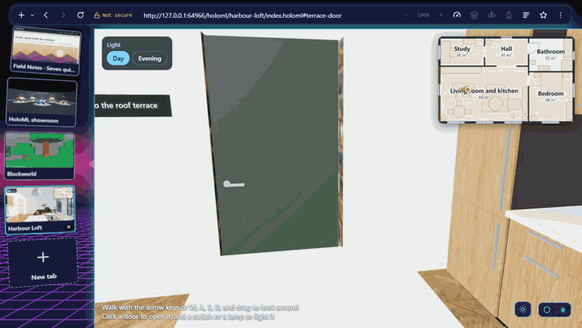

# A browser we imagined in 2001, built in 17 days with 203 prompts

*Draft for the owner's edits (GitHub issue #98, the promotion plan's
step 11). The owner posts it on dev.to or their own site; this file
keeps the draft. Every number below is from the repositories' own
records as of 2026-10-19, with where each comes from in the notes at
the end. Places marked **[owner]** need your own words or a check;
nothing there has been made up for you. For dev.to, the pictures need
their raw addresses (`https://raw.githubusercontent.com/srajpal/hypersol-hyperspace-3d/main/docs/...`),
listed in the notes.*

Other titles to choose from:

- "HyperSpace 3D: an open-source 3D browser, 25 years late"
- "We wanted a 3D web browser in 2001. In 2026 I directed AI agents to
  build it, in the open"
- "203 prompts: how a browser and a 3D markup language were built by
  AI agents, and checked by nearly 2,000 tests"

---



## 2001: a browser that let you do what others would not

In December 2000, two computer engineering students who had met at
Florida Atlantic University, Mauricio Sadicoff and I, started a small
software company in Florida. In early 2001 it became HyperSol.

Our first product was a web browser, HyperSol WebSurfer. We wrote it,
as our site said then, "when we needed some features that no other
browser would allow". The first of them was control over the pop-up
windows that buried the web of 2001. Once we were writing a browser
anyway, we kept going: themes that changed the whole browser, its
pictures, buttons, and sounds, not just its colours; pages that
refreshed themselves for stock quotes and headlines; and a full HTML
editor built in. WebSurfer 1.0.0 shipped on March 5, 2001, free, for
Windows 95 to ME. Eight days later it was at 1.0.6.

Behind it sat a bigger idea: a browser where the web is not flat. You
would look *into* it, not *at* it. Between 2001 and 2003 that idea had
a name, HyperSpace 3D, and a concept screen, a blue cube tilted toward
you over a loading bar. It never shipped. The graphics cards, the
graphics programming interfaces, and the web platform were not ready
for it, and neither, honestly, were we.


HyperSol no longer exists. **[owner: a line or two on what happened
to the company and to the two of you, if you want it here.]**

## 2026: twenty-five years later

This year is HyperSol's 25th. I wanted to mark it by finally building
that idea, in the open, for anyone. And I wanted to find out how far
the new way of making software goes: I would not write the code. AI
coding agents would. My job was to decide what to build, approve each
plan, and check that what came back was right.

The result is two open-source projects, both Apache 2.0:

- **[HyperSol HyperSpace 3D](https://github.com/srajpal/hypersol-hyperspace-3d)**,
  a desktop web browser with a 3D interface. Any ordinary website sits
  on a tilted panel in a 3D room, with its tabs as cards in an arc
  beside it. A layers view lifts a page's sections and pictures to
  different depths. You can lift a page's pictures and 3D models off
  it and into the room, turn them, and put them back. You can leave
  the desk and look around the room. It blocks ads and trackers,
  sends its DNS encrypted, loads pages over HTTPS only, and sends no
  telemetry at all.
- **[HoloML](https://github.com/srajpal/holoml)**, a markup language
  for fully 3D websites, kept as plain as HTML. A HoloML page places
  glTF models in a scene with lights, materials, labels, links, sound,
  and a little script, and the browser lets you walk through it.

You can try both without installing anything. Open
[Harbour Loft in your browser](https://srajpal.github.io/hypersol-hyperspace-3d/viewer/?page=https://srajpal.github.io/holoml/harbour-loft/index.holoml):
it is a flat by a harbour, written in HoloML. Walk with the arrow keys
or W, A, S, D, open the doors with a click, switch the lamps on, and
go up to the roof terrace. Six more examples are on the
[landing page](https://srajpal.github.io/hypersol-hyperspace-3d/): a
car showroom, a block game, a sofa shop where the fabric changes in
place, a sneaker store, an ocean tunnel with fish, and a room of words
in many languages. To write a page of your own, HoloML's
[playground](https://srajpal.github.io/holoml/playground/) has the
markup on the left, the scene on the right, and the checker's problems
as you type. The browser itself is a portable zip for Windows, macOS,
and Linux on the
[0.9.2 release](https://github.com/srajpal/hypersol-hyperspace-3d/releases/tag/v0.9.2).


## How it was built: 203 prompts, in public

The first prompt was on 24 September 2026. The 203rd, which closed the
last planned milestone, was on 10 October: seventeen days. In between
the agents made about 770 commits across the two repositories, and
every prompt I gave them is published, in order, in
[PROMPTS.md](https://github.com/srajpal/hypersol-hyperspace-3d/blob/main/PROMPTS.md),
lightly edited for typing slips, with the date and the model each one
went to.

The first prompt did not ask for code. It described the idea in a
few paragraphs, then said:

> Ask me important questions that would help build the first
> version, then wait for my answers. [...] Show me the draft. After I
> approve it, save BRIEF.md. Do not write app code or start another
> step.

That set the pattern for everything after. I work the way I teach in
[Buildwright](https://buildwrightcourses.com), in five moves:

1. **Brief.** Who the software is for, the problem, and the first
   useful result. The agent asked nine questions; I answered them in
   nine short lines (prompt 2), and it wrote
   [BRIEF.md](https://github.com/srajpal/hypersol-hyperspace-3d/blob/main/BRIEF.md).
   One answer was "embed an existing engine", which ruled out writing
   a browser engine from scratch. Another was "if 3DML is taken, try
   to find a name that is not". It was taken, and that is how the
   language became HoloML.
2. **Architect.** How the parts fit: Electron for Chromium, so real
   websites work from the first day; Three.js for the room; the live
   page placed with CSS 3D transforms; SQLite for history and
   bookmarks. The screens, what is saved, and what happens while
   waiting or when things fail, all written down in
   [ARCHITECTURE.md](https://github.com/srajpal/hypersol-hyperspace-3d/blob/main/ARCHITECTURE.md)
   before any code.
3. **Decompose.** Twenty-eight milestones, each with its tasks and its
   checks written before it was built, in
   [TODO.md](https://github.com/srajpal/hypersol-hyperspace-3d/blob/main/TODO.md).
4. **Delegate.** For each milestone the agent proposed a plan with
   questions, I answered (often "Q1 a, Q2 a": its recommendations),
   and approved the build. A typical milestone took three to six
   prompts.
5. **Verify.** I tried every milestone myself before accepting it, and
   the agents had to prove each check had actually run.

The rules the agents worked under are in
[AGENTS.md](https://github.com/srajpal/hypersol-hyperspace-3d/blob/main/AGENTS.md),
and most of them are about honesty, not code: build only what has been
approved; ask before adding any software; "never invent results"; mark
a command "not checked yet" until it has really run; and never remove
or weaken a test, or an assertion, to get a pass. Fix the code, or
report the failure and ask.

## What the agents got wrong, and what caught it

This is the part I most wanted to write down, because it is where the
work really was. The agents were fast and capable, and they were also
wrong in all the ways a fast, capable programmer is wrong. What caught
them was mostly tests, and a few times it was me.

- **A security rule that did nothing.** HoloML pages declare what they
  may do, and `webrtc 'block'` was meant to stop a page making peer
  connections. While building HoloML 0.3, a check found Chromium
  ignores that rule: pages could make peer connections all along. The
  fix takes those interfaces out of the page's JavaScript altogether
  (viewer/guard.ts), and a check proves it.
- **A review that found what the tests did not.** After milestone 22
  I asked for a thorough review of both repositories. Ten review
  agents read every file of one area each, and the findings were
  ranked from "before anything is released" down. It found real
  faults, among them ones serious enough to file as security
  advisories, and all were fixed, each with a check that fails
  without its fix. A later review of older snapshots found three more
  advisories (a private tab that could read data from one being
  cleared, and two ways the Library could show a password it should
  have forgotten). All are published on the repository's Security
  page.
- **Tests that passed for the wrong reason.** A check that something
  does *not* happen, say that an idle page draws no frames, passes
  trivially if it looks too early. These checks now wait until the app
  has dealt with everything the page sent it, and only then look.
  Checks that hold a key in a 3D scene hold it for the scene's own
  time, not the clock's, because a scene drawn slowly runs behind.
  A sleep proves nothing on a slow machine.
- **Machines without a graphics card.** GitHub's build machines draw in
  software. The aquarium was too slow there, so its models got
  triangle budgets. Frame-rate budgets cannot hold in software, so
  those checks report "skipped", never "passed".
- **macOS.** The browser was built on Windows and checked on Windows
  and Linux. On my Mac, 17 of 463 end-to-end checks missed. Each was
  settled one at a time as the app's fault or the check's, and no
  check was weakened to get there.
- **What only a person sees.** On my Android tablet the tab cards were
  blurred. A picture of the sky came out upside down. A very tall page
  went blank in the layers view, found while taking screenshots. Each
  became a fix and a check.

Today the browser has 614 unit tests and 480 end-to-end checks, which
drive the real app with Playwright on Windows and Linux on every
change, and on macOS on main; HoloML has 885 tests of its own, including conformance
samples for the language. **[owner: one honest sentence on how much
you read of the code yourself, and what you looked at most.]**

## What the 3D web could be

HoloML is not the first attempt at 3D on the web. VRML, X3D, A-Frame,
and model-viewer all came before it, and HoloML builds on what they
taught: its models are glTF 2.0, the open standard, and its syntax is
strict and HTML-like. What it tries to add is a page you would write
for a person, not for a 3D programmer:

```html
<holoml version="0.3">
  <scene background="#0b0f1e">
    <viewpoint position="0 1.6 6" look-at="0 0.8 0" mode="orbit" />
    <light type="directional" position="4 8 5" intensity="1.2" />
    <a href="coupe.holoml">
      <model src="models/coupe.glb" rotation="0 30 0">
        <material name="Paint" color="#c0182a" />
      </model>
    </a>
    <label position="0 2.1 0">The coupe: click to walk around it</label>
  </scene>
</holoml>
```

That is a whole page, HoloML's README's own sample: a red coupe you
orbit, a label over it, and a click that takes you to a page where you
walk around it.

Every model a screen reader reaches has a name, every page has a text
view, Tab moves through a scene's links, and reduced motion is
respected. Limits on file sizes, triangles, and a script's time keep a
heavy page from taking the machine down with it. The language is
written down as a specification in the W3C's style, with a grammar, a
schema, and the scene's programming interface in Web IDL, so that
someone else could write a second viewer.

It is experimental. Version 0.3 is the third release in a month, and
the open issues list what is missing: forms, reusable components,
richer pointer events, and more.

## What is next

- **HoloML's parser and checker on npm**, and its VS Code extension in
  the editors' registries.
- **The browser's open issues**, one at a time: a screen-reader pass
  over its own interface, sharper text on the tilted page, and the
  browser's own full screen. Two are marked "good first issue".

If you try it, I would love to hear what breaks. Issues and
Discussions are open on both repositories.

---

## Notes for the owner (not part of the article)

Where each number comes from (2026-10-19; the test counts 2026-10-20):

| Claim | Source |
|---|---|
| 17 days, prompts 1 to 203 | PROMPTS.md headings: prompt 1 on 2026-09-24, 203 on 2026-10-10 |
| About 770 commits | `git rev-list --count HEAD`: 606 here (on main), 164 in holoml |
| 28 milestones | TODO.md, the roadmap |
| Models | PROMPTS.md: 176 prompts to Claude Opus 5.5, 28 to Claude Fable 5.1, 3 to Codex. Say so if you name the tools. |
| 614 unit tests | TODO.md, "Issue #127", results (2026-10-20) |
| 480 end-to-end checks (the full run of 2026-10-20); 17 of 463 missed on the Mac (2026-10-15) | TODO.md, "Issue #94", MC3; "Issue #111" |
| 885 HoloML tests | TODO.md, "Issues and advisories of 2026-10-09" |
| WebRTC rule ignored | TODO.md, milestone 25 results, and "After milestone 25" |
| Ten reviewers | TODO.md, "The review of 2026-09-30", "What was reviewed, and how" |
| Three advisories of 2026-10-09 | TODO.md, "Issues and advisories of 2026-10-09"; published 2026-10-10 |
| Blurred cards, the sky, the tall page | TODO.md, milestones 24, 19 (V6), and 22 (Y7b) |
| 2001 history and the quotes from the old site | README.md, "The story" |

Pictures by raw address, for dev.to:

- https://raw.githubusercontent.com/srajpal/hypersol-hyperspace-3d/main/docs/video/hyperspace-3d.gif
- https://raw.githubusercontent.com/srajpal/hypersol-hyperspace-3d/main/docs/history/hyperspace-3d-concept-2001-2003.jpg
- https://raw.githubusercontent.com/srajpal/hypersol-hyperspace-3d/main/docs/screenshots/readme.png

Before posting:

- dev.to tags (four at most): `opensource`, `webdev`, `threejs`, `ai`.
- Post it a day or two before launch day, so the Show HN can link it
  (docs/launch/).
